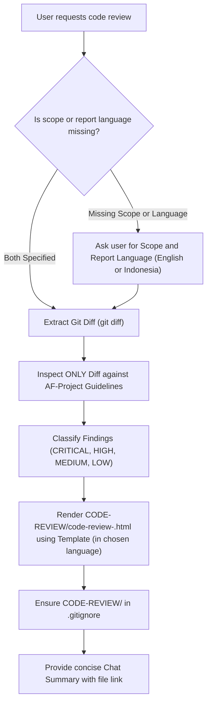

# Code Review Guidelines & Checklist

Use this standard procedure whenever reviewing a pull request, commit, branch comparison, or local patch in an AF-Project.

---

## 1. Review Scope & Workflow

### 1.1 Scope Detection & Ambiguity Handling
Before performing any code review, determine the exact diff target:

| Review Type | Command / Scope | When to Use |
| :--- | :--- | :--- |
| **Between Branches** | `git diff <base-branch>...<head-branch>` | When reviewing a Feature Branch, PR, or branch comparison (e.g., `origin/main...feature/user-auth`). |
| **Single Commit** | `git diff <commit-sha>^!` or `git show <commit-sha>` | When reviewing a specific commit by hash or latest commit (`HEAD^!`). |
| **Uncommitted Changes** | `git diff HEAD` (or staged `git diff --cached`) | When reviewing local working directory modifications. |

> [!IMPORTANT]
> **Always Ask for Clarification If Scope is Ambiguous**  
> If the user simply requests *"review my code"* or *"can you review this?"* without specifying a commit or branch comparison:
> - **DO NOT assume the scope.**
> - Immediately ask whether to review:
>   1. The latest local commit (`HEAD^!`)
>   2. A specific commit SHA
>   3. A branch comparison against a base branch (e.g. `main` or `develop`)
>   4. Currently uncommitted/staged working changes.

### 1.2 Mandatory Report Language Selection
> [!IMPORTANT]
> **ALWAYS Ask the User for Report Language Preference (English or Indonesia)**  
> Before generating any code review HTML report, **ALWAYS ask the user whether they want the report in English or Indonesia (Indonesian)**.
> - **DO NOT assume the language.** Never default to English or Indonesian without explicit user confirmation.
> - If the review scope is ambiguous, ask for both the **scope target** and the **report language (English or Indonesia)** together in the clarifying question.
> - If the user explicitly provided the scope target but did not specify the report language, **ask the user for their preferred report language** before generating the report.
> - All narrative and descriptive content in the generated HTML report must match the chosen language:
>   - **Executive summary note & verdict badge** (e.g. `CHANGES REQUIRED` / `PERUBAHAN DIPERLUKAN`, `APPROVED` / `DISETUJUI`).
>   - **Inspection findings section heading & labels**.
>   - **Finding Titles** (e.g. `Unwrap Used in Production Service` vs `Unwrap Digunakan pada Layanan Produksi`).
>   - **Reason & Impact explanations** (`Reason` / `Impact` vs `Alasan` / `Dampak`).
>   - **Suggested fix descriptions and notes**.
>   - **AI Prompt container for excluded findings** (`Remove findings number...` vs `Hapus temuan nomor...`).

### 1.3 Strict Diff-Only Boundary
- **Only review modified and added lines in the diff.**
- **NEVER review or flag untouched, pre-existing code** outside the diff.
- Do not nitpick legacy code or unrelated technical debt that was not touched by the author.
- If a changed line interfaces with existing code, focus recommendations strictly on the safety, correctness, and architecture conformance of the change itself.

---

## 2. Review Priorities

### 2.1 Preserve Business Flow
- **Do not alter business flows or user journeys.**
- Fixes must focus on code quality, performance, architecture conformance, stability, and security.
- Any suggested code change must be a drop-in safe replacement that preserves the intended feature behavior.

### 2.2 Quality & Stability Standards

Inspect every changed line against the AF-Project golden standards:

#### Backend (Rust / Actix):
- **Zero Unwraps in Production**: Reject `.unwrap()` or `.expect()` in production code paths. Error handling must use `Result<T, AppError>` and the `?` operator.
- **Unified API Envelope**: Ensure all endpoints return `AppResponse<T>` (`Result<Json<BaseResponse<T>>, AppError>`) via `.json()` or `.json_data()`.
- **Async & Thread Safety**: Never execute CPU-heavy blocking work on Actix worker threads without `web::block`. Avoid deadlocks in shared locks (`Arc<Mutex<T>>` or `RwLock<T>`).
- **Parameterized SQL**: All database operations must use parameterized queries (`sqlx::query!`, `sqlx::query_as!`). String concatenation in SQL is strictly forbidden.

#### Frontend (SvelteKit / Svelte 5):
- **Svelte 5 Runes Only**: Reject legacy Svelte 3/4 syntax (`export let`, `$:`, `on:click`). Require `$props()`, `$state()`, `$derived()`, and `$effect()`.
- **Pure CSR Mode**: Verify `export const ssr = false;` in the root `+layout.ts`. Never allow server routes (`+page.server.ts` or `+server.ts`).
- **Zero-Egress E2E Tests**: Playwright tests must mock all API calls; no live network egress during browser journeys.
- **Styling Cleanliness**: Reject Tailwind `@layer components` or global `@apply` abstractions for feature- or page-specific styling.

#### Cross-Cutting & Security:
- **No Hardcoded Secrets**: Reject hardcoded API keys, JWT secrets, database credentials, or sensitive URLs.
- **No Stray Debug Prints**: Clean up `dbg!()`, `println!()`, or `console.log()` statements.
- **Natural Language Commits**: Natural language commit messages only (no Conventional Commit prefixes like `feat:`, `fix:`).
- **Append-Only Migrations**: Database migrations must be new sequential files under `backend/migrations/`; never edit applied migrations.

---

## 3. Architecture & Boundary Rules

Ensure all changes respect AF-Project layered architecture:

### 3.1 Backend Layer Segregation
- **Entities Layer (`backend/src/entities/`)**:
  - Pure domain models, schemas, and DTOs only.
  - NEVER place SQL queries, database connections, HTTP logic, or business rules in `entities/`.
- **Repositories Layer (`backend/src/repositories/`)**:
  - Database access only using parameterized SQL.
  - No HTTP request handling, response formatting, or domain validation.
- **Services Layer (`backend/src/services/`)**:
  - Business logic orchestration, validation, and third-party service calls.
- **Routes Layer (`backend/src/routes/`)**:
  - Thin HTTP handlers: extract parameters, call service functions, and return `AppResponse<T>`.

### 3.2 Frontend Architecture
- Feature components belong under `src/routes/...` or `src/lib/components/...`.
- Shared API access must route through `src/lib/api.ts`.
- Theme tokens and global styling reside in `src/app.css`.

---

## 4. Testing Review

- **Backend Verification**:
  - Format check: `cargo fmt --check`
  - Tests: `cargo test`
  - Clippy: `cargo clippy --all-targets --all-features --locked -- -D warnings`
  - Ensure new public routes, service functions, and repository queries have corresponding test coverage.
- **Frontend Verification**:
  - Type check: `bun run check`
  - Linter: `bun run lint`
  - Unit tests: `bun run test:unit`
  - Format check: `bun run format:check`
  - E2E tests: `bun run test:e2e`

---

## 5. Review Output Artifact

Every code review must generate a clean, self-contained HTML report file:

### 5.1 Output Path & Slug Convention
Save the generated review report to:
```text
CODE-REVIEW/code-review-<slug>.html
```
- Create the `CODE-REVIEW/` folder in the project root if it does not exist.
- **Ensure Git-Ignored**: Make sure `CODE-REVIEW/` is ignored in the project's `.gitignore` so generated reports are never committed into the repository. If `CODE-REVIEW/` is not present in `.gitignore`, append `CODE-REVIEW/` to `.gitignore`.
- **Slug Format Rules**:
  - Lowercase alphanumeric characters.
  - Replace spaces, slashes (`/`), underscores (`_`), and special characters with a single hyphen (`-`).
  - *Example (Branch):* `feature/user-auth` &rarr; `CODE-REVIEW/code-review-feature-user-auth.html`
  - *Example (Commit):* `Fix session token expiry (8a3d1f2)` &rarr; `CODE-REVIEW/code-review-fix-session-token-expiry-8a3d1f2.html`

### 5.2 HTML Template & Design Standard
The report must be rendered using the enterprise design template located at:
[`skills/af-project/templates/code-review-template.html`](../templates/code-review-template.html)

#### Key UI Specifications:
- **Design Reference**: Authentic monochrome aesthetic (clean dark black `#050507` / `#0C0C0E` in dark mode, crisp light `#F8FAFC` / `#FFFFFF` in light mode, hairline borders, high information density).
- **Official AF-Project Brand Mark**: Uses the AF-Project vector logo with `fill="currentColor"`.
- **Theme Modes (No Emojis)**: Minimalist Light and Dark mode toggle using clean SVG outline icons (no emojis), persistent via `localStorage`.
- **Top Navbar Scope Badge (`.ref-badge`)**:
  - Displays the full branch name or target scope (`{{BRANCH_NAME}}`).
  - **Never Truncated**: In the top navbar, the branch name must **never be truncated** (no truncation, no ellipsis `...`, full branch name must always be displayed).
- **Executive Summary Bar**:
  - Metadata block:
    - **Target Scope**: Full diff target scope or branch comparison.
    - **Architecture / Stack**: Detected project stack (e.g. `Rust Actix + SvelteKit 3`).
    - **Timestamp**: Must strictly follow the format `Sun, 1 Jun 2026 18.30 WIB` (`<DayName3>, <Day> <MonthName3> <YYYY> <HH>.<mm> <TIMEZONE>`). Note the dot (`.`) separator for hours/minutes and local timezone (e.g. `18.30 WIB`).
    - **Reviewer**: Value must strictly be the current git user (`name`), retrieved from git config via `git config user.name`.
  - Review verdict badge with SVG icon: `CHANGES REQUIRED` or `APPROVED` (or `PERUBAHAN DIPERLUKAN` / `DISETUJUI` when report language is Indonesia).
  - Severity proportional breakdown bar and filter tabs (`All`, `Critical`, `High`, `Medium`, `Low`).
- **Severity Classification & Vibrant Colors**:

| Severity | Color & Accent | Definition |
| :--- | :--- | :--- |
| **`CRITICAL`** | Crimson / Red (`#EF4444`) | Production panic/unwrap, SQL injection, hardcoded credential, broken layer segregation, data corruption, build-breaking error. |
| **`HIGH`** | Orange (`#F97316`) | Concurrency race condition, legacy Svelte syntax, server route in CSR mode, missing error mapping, E2E test making unmocked live egress. |
| **`MEDIUM`** | Warm Amber (`#F59E0B`) | Missing unit test coverage, Tailwind `@layer components` for feature styling, magic numbers, missing validation. |
| **`LOW`** | Emerald / Green (`#22C55E`) | Naming convention inconsistency, minor formatting, leftover debug prints. |

- **Minimum Required Content per Finding**:
  1. **Numbered Index**: Every finding must be explicitly numbered as `#1`, `#2`, `#3`... (not `#01`).
  2. **Severity Badge, Category & Language**: e.g. `#1` &bull; `CRITICAL` &bull; `Security` &bull; `Rust`.
  3. **File Path & Line Reference**: Exact file path and line numbers with file SVG icon.
  4. **Concise Rationale Panel**:
     - *Reason*: Direct technical cause of the issue (non-verbose).
     - *Impact*: Practical consequence (crash risk, security vulnerability, layer violation) — title and description text dynamically colored based on severity (CRITICAL: Red, HIGH: Orange, MEDIUM: Amber, LOW: Green).
  5. **Responsive Code Viewer with Line Numbers & Syntax Highlighting**:
     - **Always Dark Theme**: Code blocks remain in dark black (`#050507` / `#0C0C0E`) even when viewing the report in light mode.
     - Embedded Prism syntax highlighting supporting **Rust**, **TypeScript**, **JavaScript**, **Svelte / HTML**, **CSS**, **SQL**, **JSON**, **YAML**, **TOML**, **Python**, **Go**, **Bash/Shell**, **C/C++**, and **Swift**.
     - Aligned line numbers in an unselectable column (`user-select: none; pointer-events: none;` so line numbers are never copied when highlighting code).
     - **Current Code (Diff)**: Must display the git diff between **before vs after changes** (the commit/PR diff showing deleted lines `-` and added lines `+`). **NEVER** show a diff between after changes vs the fix suggestion here.
     - **✨ Suggested Fix**: Clean replacement code (without diff markers) with line numbers and a one-click **Copy Code** button.
  6. **Interactive Finding Selection & Floating AI Prompt**:
     - **Circled "Valid" Checkbox**: Each finding card includes a **"Valid"** checkbox at the top right, positioned directly above the file path (default: all checked). The checkbox icon must be circled (`border-radius: 50%`) with a circled check icon, not a square.
     - **Floating AI Exclusion Prompt**: When one or more findings are unchecked (unselected > 0), the **"AI Prompt (Excluded Findings)"** container automatically floats at the bottom of the viewport with a circled **"Request Fix"** checkbox (default: checked, placed to the left of the Copy Prompt button) and a one-click **Copy Prompt** button.
       - When "Request Fix" is checked: generates `Remove findings number #1, and fix the remaining findings!` (or `Hapus temuan nomor #1, dan perbaiki temuan yang tersisa!`).
       - When "Request Fix" is unchecked: generates `Remove findings number #1!` (or `Hapus temuan nomor #1!`).

---

## 6. Review Execution Step-by-Step

When tasked with conducting a code review, follow these exact steps:



1. **Clarify Scope & Report Language**:
   - Confirm target branch comparison or commit.
   - **ALWAYS ask the user whether they want English or Indonesia for the report (HTML)** before proceeding if they haven't explicitly stated it.
2. **Collect Diff & Metadata**:
   - Run `git diff` for the scoped target. Do not inspect files outside the diff.
   - Run `git config user.name` to fetch the current git user name for the Reviewer field (`{{REVIEWER_NAME}}`).
   - Format the current timestamp strictly as `Sun, 1 Jun 2026 18.30 WIB` (dot separator for time, local timezone like `WIB`).
3. **Inspect ONLY Diff against AF-Project Standards**: Check for layer segregation, production unwraps, API envelope, Svelte 5 runes, CSR mode, E2E egress, migrations, and security.
4. **Evaluate Findings & Classify Severity**: Group and rank findings as CRITICAL, HIGH, MEDIUM, or LOW.
5. **Generate HTML Report**:
   - Slugify the branch or commit name.
   - Populate `skills/af-project/templates/code-review-template.html` in the user's chosen language (English or Indonesia).
   - In the top navbar (`.ref-badge`), display the full branch name and ensure it is **never truncated**.
   - Ensure the Reviewer field uses the current git user (`git config user.name`).
   - Ensure the Timestamp field strictly follows `Sun, 1 Jun 2026 18.30 WIB`.
   - Ensure the "Valid" checkbox icon is circled.
   - In "Current Code (Diff)", ensure the diff shows **before vs after changes** from the git diff (`-` for deleted, `+` for added lines in the commit/PR), **NOT** after changes vs fix suggestion.
   - In "✨ Suggested Fix", provide the clean replacement code ready for copy-pasting.
   - Write out to `CODE-REVIEW/code-review-<slug>.html`.
6. **Ensure Git-Ignored**:
   - Verify that `CODE-REVIEW/` is ignored in the project's `.gitignore`.
   - If not already present, add `CODE-REVIEW/` to `.gitignore` to prevent generated reports from being tracked.
7. **Report in Chat**:
   - Provide a concise summary in chat highlighting:
     - Target scope, reviewer name, & overall verdict
     - Metrics breakdown (Critical / High / Medium / Low)
     - Top critical findings (with exact file:line references)
     - Direct clickable link to the generated HTML report.

---

## 7. Git Safety

- **Never run `git push --force`**.
- If a push fails due to a diverged remote branch, explain the situation clearly and ask the user how to proceed.
- `--force-with-lease` is only permitted when explicitly requested by the user.
