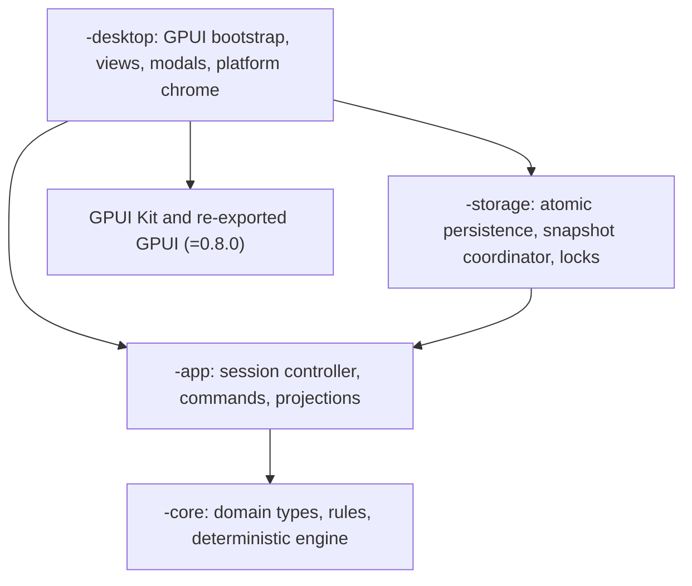

# Desktop Foundations

This guide defines the foundational setup, workspace configuration, dependency pinning, and core runtime architecture for building native desktop applications in Rust using GPUI and GPUI Kit, based on the proven 4-crate architectural standard.

---

## 1. Multi-Crate Workspace Architecture

Desktop applications are structured as a clean, acyclic 4-crate Cargo workspace. This separation guarantees deterministic domain logic, testability without window managers, safe persistence, and a decoupled UI runtime:



### Crate Invariants & Boundaries

1. **`<app>-core` (Domain & Engine)**:
   - Contains pure business logic, mathematical rules, and state machines.
   - **Zero external side-effects**: Strictly prohibited from importing UI frameworks, storage, OS clocks, system random generators, or filesystem APIs.
   - Deterministic and 100% testable via pure unit and invariant contract tests.

2. **`<app>-app` (Application & State Controller)**:
   - Owns the `SessionController`, command dispatch, account/session state, and projection derivation.
   - Defines the abstract repository ports (e.g., `SessionRepository` trait) and persistable snapshot DTOs.
   - **Zero UI and concrete storage**: Never imports GPUI or concrete OS filesystem adapters.
   - Testable via fast workflow tests without spawning OS windows.

3. **`<app>-storage` (Persistence & File Coordination)**:
   - Implements the application layer's repository ports.
   - Manages versioned JSON snapshots, profile file locking (`.lock`), and background save coordination.
   - **Zero UI callbacks**: Communicates with the application layer solely through data structures and traits. Never triggers UI re-renders or imports views.

4. **`<app>-desktop` (Presentation & Packaging)**:
   - Concrete application entrypoint (`main.rs`).
   - Owns GPUI models, views, custom controls, keyboard actions, modals, and platform window chrome.
   - Coordinates background workers and passes cached projections behind `Arc<T>` to views.
   - Owns native asset embedding and OS packaging pipelines.

---

## 2. Workspace Toolchain & Dependency Pinning

To guarantee reproducible builds across developer machines and CI pipelines, all desktop workspaces must strictly pin the compiler and key UI dependencies:

### `rust-toolchain.toml`
```toml
[toolchain]
channel = "1.97.1"
components = ["rustfmt", "clippy"]
targets = ["aarch64-apple-darwin", "x86_64-apple-darwin", "x86_64-pc-windows-msvc", "x86_64-unknown-linux-gnu"]
```

### Workspace Root `Cargo.toml`
```toml
[workspace]
members = [
    "crates/<app>-core",
    "crates/<app>-app",
    "crates/<app>-storage",
    "crates/<app>-desktop",
]
resolver = "3"
default-members = ["crates/<app>-desktop"]

[workspace.package]
version = "0.1.0"
edition = "2024"
rust-version = "1.97"
license = "MIT"

[workspace.dependencies]
<app>-core = { path = "crates/<app>-core" }
<app>-app = { path = "crates/<app>-app" }
<app>-storage = { path = "crates/<app>-storage" }

# Pinned GPUI snapshot via GPUI Kit
gpui-kit = "=0.8.0"

# Serialization & Core Utilities
serde = { version = "=1.0.229", features = ["derive"] }
serde_json = "1.0"
thiserror = "=2.0.21"
chrono = { version = "=0.4.45", default-features = false, features = ["std"] }
rand = "=0.9.4"

[workspace.lints.clippy]
all = "warn"

[profile.release]
lto = "thin"
codegen-units = 8
strip = "none"
```

> [!CAUTION]
> Always use `gpui_kit` re-exports and its matching GPUI snapshot. Do NOT independently track upstream Zed `main`, override snapshot crates, or mix GPUI forks. Upgrade Kit, GPUI, compiler toolchain, and `Cargo.lock` together as an atomic update. Always run cargo with `--locked`.

---

## 3. Concurrency Model & UI Responsiveness

Desktop applications enforce a strict threading architecture to prevent UI freezes and ensure deterministic state updates:

```text
┌─────────────────────────────────────────────────────────────────────────────┐
│ UI Thread / GPUI Main Executor                                              │
│                                                                             │
│  [User Action] ──> [cx.dispatch_action] ──> [SessionController.apply()]     │
│                                                          │                  │
│  [Views Re-render] <── [cx.notify()] <── [Update Arc<T>] │                  │
└──────────────────────────────────────────────────────────┼──────────────────┘
                                                           │ (Debounced channel)
                                                           ▼
┌─────────────────────────────────────────────────────────────────────────────┐
│ Dedicated Background Storage Worker (Non-blocking)                          │
│                                                                             │
│  [Save Coordinator] ──> [Serialize JSON] ──> [Atomic Swap via .tmp / .bak] │
└─────────────────────────────────────────────────────────────────────────────┘
```

1. **Single State Owner on UI Thread**:
   - The `SessionController` (in `<app>-app`) is owned by the GPUI `Model` on the main UI executor.
   - All domain state mutations are strictly sequential and executed on the UI thread.
2. **Zero Disk or Network I/O on UI Thread**:
   - Never perform synchronous file reading/writing, database access, or network calls inside GPUI view render loops or action handlers.
   - Disk persistence is offloaded to a dedicated background worker thread using cross-thread channels (`mpsc` or `crossbeam-channel`).
3. **Debounced Persistence & Coalescing**:
   - Consecutive rapid user actions (e.g. typing, slider dragging) coalesce saves using a debounce window (typically 250 ms) to avoid thrashing disk I/O.
4. **Projections Behind `Arc` Slices**:
   - Views never take mutable locks on domain models.
   - The controller produces immutable snapshot projections wrapped in `Arc<Projection>`, enabling views to read data with zero lock contention and minimal cloning.

---

## 4. Error Handling Hierarchy

Error handling is organized into strictly typed domain errors per layer, with zero uncaught panics:

| Layer | Error Type | Responsibility |
| :--- | :--- | :--- |
| `<app>-core` | `DomainError` | Invariant violations, business rule rejections, arithmetic boundary errors |
| `<app>-app` | `AppError` | Command validation failures, unauthorized operations, session state errors |
| `<app>-storage` | `StorageError` | I/O failures, schema mismatches, serialization errors, profile lock conflicts |
| `<app>-desktop` | Toast / Dialog Notification | Presents user-friendly feedback; maps error severity without panicking |

```rust
// Inviolable Rule: Zero unwrap() or expect() in production code paths
// Always propagate errors or provide explicit user-facing fallback
let profile = storage.load_profile(&path).map_err(|err| {
    log::error!("Failed to load profile: {err:?}");
    AppError::PersistenceFailure(err.to_string())
})?;
```

---

## 5. Application Bootstrap Flow (`main.rs`)

The desktop application initializes in standard sequence:

1. **Environment & Logging Initialization**: Initialize logging subscriber (e.g. `env_logger` or `tracing`) with sensible defaults for release vs debug.
2. **Directory & Lock Setup**: Locate standard OS application data directories (via `dirs` crate: `~/Library/Application Support/<app>` on macOS, `%APPDATA%\<app>` on Windows, `~/.local/share/<app>` on Linux). Acquire the exclusive profile `.lock`.
3. **Storage & Controller Wiring**: Initialize storage repository, restore the latest validated snapshot or initialize fallback default state.
4. **GPUI Application Launch**:
   ```rust
   use gpui::prelude::*;
   use gpui::{App, AppContext, WindowOptions, Bounds, size, px};

   fn main() {
       let app = App::new();
       app.run(|cx: &mut AppContext| {
           // Register GPUI Kit components and theme
           gpui_kit::init(cx);
           
           // Spawn main window with clamped default dimensions
           let bounds = Bounds::centered(None, size(px(1440.0), px(900.0)), cx);
           cx.open_window(
               WindowOptions {
                   window_bounds: Some(gpui::WindowBounds::Windowed(bounds)),
                   ..Default::default()
               },
               |cx| cx.new_view(|cx| MainWorkspaceView::new(cx)),
           ).expect("failed to open main window");
       });
   }
   ```
